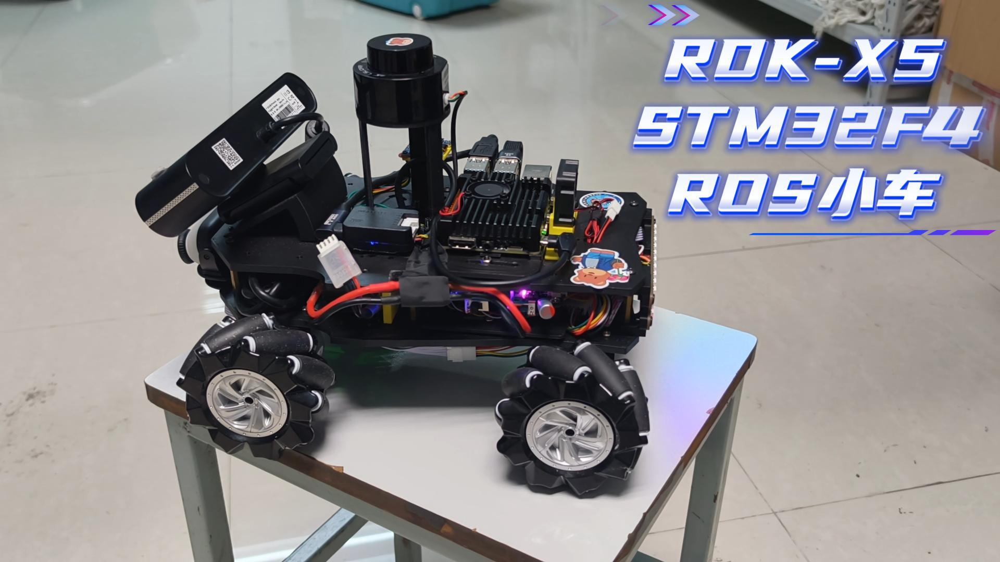

# ROS Car · STM32F405 + RDK X5

基于 **STM32F405RGT6、RDK X5 与 ROS 2 Humble** 的四轮麦克纳姆轮小车。仓库集中提供下位机固件、上位机源码、PCB 工程、机械结构和部署教程。



STM32 负责四轮编码器测速、电机 PID、IMU 姿态、ELRS 遥控与串口通信；RDK X5 通过 ros2_control 驱动底盘，使用 SLAM Toolbox 建图和 Nav2 全向导航。支持板卡运行算法，或板卡运行硬件、电脑运行算法与 RViz 两种部署方式。

## 资料导航

| 内容 | 入口 |
| --- | --- |
| STM32 固件、CubeMX / CMake / Keil 工程 | [ROS_car_V1](ROS_car_V1/README.md) |
| VS Code + DAPLink 编译烧录 | [固件环境教程](ROS_car_V1/docs/01_vscode_daplink.md) |
| 接线、电机、编码器和传感器 | [硬件与参数](ROS_car_V1/docs/02_hardware.md) |
| ROS 2 源码及各包说明 | [RDKX5Car/src](RDKX5Car/src/README.md) |
| 板卡、电脑的安装与运行 | [RDK X5 部署入口](RDKX5Car/README.md) |
| 控制板、RGB 灯板、无线串口板 | [PCB 工程与预览](hardware/README.md) |
| 底盘、转接板和打印支架 | [机械结构](hardware/structure) |
| 发布包、镜像状态与校验 | [发布说明](docs/RELEASE.md) |
| 首次发布的软件检查 | [验证记录](docs/VALIDATION.md) |
| 许可证及第三方组件 | [许可说明](THIRD_PARTY_NOTICES.md) |

## 获取与使用

```bash
git clone https://github.com/goatwzz/ROS-Car-STM32-RDKX5.git
cd ROS-Car-STM32-RDKX5
```

**固件**：在 VS Code 中打开 `ROS_car_V1/`，按环境教程创建自己的 `tools/local.settings.json`，再编译和烧录。

**RDK X5**：按部署入口准备 Ubuntu 22.04 / ROS 2 Humble。可以把 `RDKX5Car/src/` 复制到自己的 ROS 工作空间，或使用保留原校验值的 `RDKX5Car/archives/WORKSPACE_SRC.tar.gz`，两者源码内容相同。

```bash
# 在已安装 ROS 2 Humble 的 Linux 环境中执行
mkdir -p ~/dev_ws
cp -a RDKX5Car/src ~/dev_ws/
source /opt/ros/humble/setup.bash
bash RDKX5Car/scripts/install_project_deps.sh ~/dev_ws
cd ~/dev_ws
rosdep install --from-paths src --ignore-src -r -y
colcon build --symlink-install --parallel-workers 1
source install/setup.bash
```

连接实车前，按教程核对 MCU 串口、实际轮速上限、轮径、轮距、轴距及传感器参数。电脑 x86_64 Docker 镜像已通过 SHA-256、gzip、镜像层完整性、Docker 导入和基础 ROS 运行检查，并以三个分片发布到 [v1.0.0 Release](https://github.com/goatwzz/ROS-Car-STM32-RDKX5/releases/tag/v1.0.0)；下载、合并与校验步骤见[发布说明](docs/RELEASE.md)。

## 项目组成

```text
ROS-Car-STM32-RDKX5/
├── ROS_car_V1/           STM32 固件、工具与联调教程
├── RDKX5Car/
│   ├── src/              ROS 2 包、雷达和相机驱动
│   ├── archives/         经 SHA-256 校验的原始源码归档
│   ├── docker/           Compose、配置模板与重建 Dockerfile
│   ├── scripts/          依赖安装、环境检查、导出和恢复
│   └── docs/             板卡及电脑部署说明
├── hardware/
│   ├── PCB/              嘉立创 EDA 专业版 .epro 工程与预览
│   └── structure/        STEP、SolidWorks、STL 与 3MF 文件
└── car_image/            整车图片
```

## 许可证

项目原创固件、文档及原创硬件设计采用 [MIT](LICENSE)。ROS 2 `x5car_*` 包保留其原有 Apache-2.0 声明；STM32 HAL/CMSIS、雷达、相机和内嵌库遵循各自许可证。详细范围见 [THIRD_PARTY_NOTICES.md](THIRD_PARTY_NOTICES.md)。
