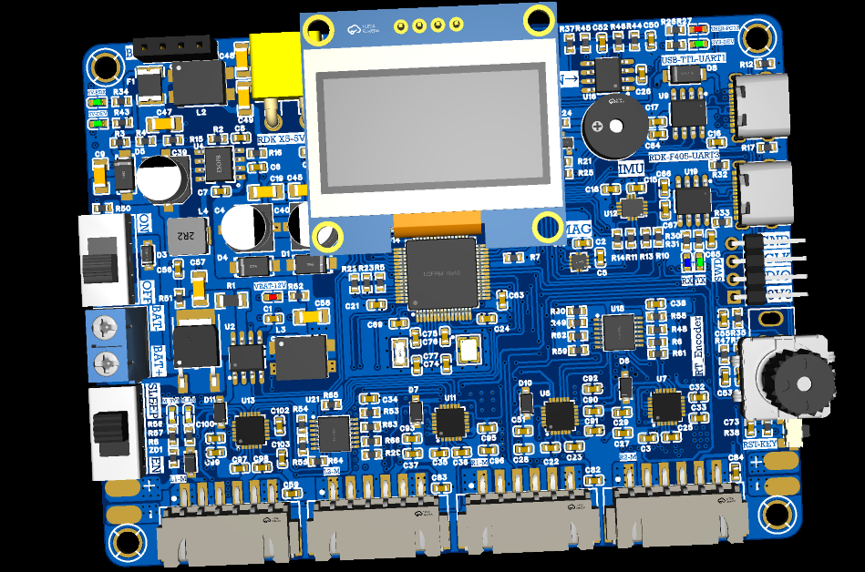

# 硬件设计

## PCB

使用嘉立创 EDA 专业版打开 `PCB/` 中的 `.epro` 工程。

| 工程 | 用途 | 预览 |
| --- | --- | --- |
| [ros小车控制板.epro](PCB/ros小车控制板.epro) | STM32 底盘控制板 | [正面](PCB/image/Controler.png) / [背面](PCB/image/controler_1.png) |
| [尾部RGB灯板.epro](PCB/尾部RGB灯板.epro) | 尾部灯板 | [预览](PCB/image/RGB_Light.png) |
| [无线调试串口.epro](PCB/无线调试串口.epro) | 无线串口板 | [预览](PCB/image/wireless_uart.png) |

## 机械结构

[structure/](structure) 包含底盘 STEP 模型、SolidWorks 电池仓和 OLED 支架，以及 RDK X5 转接板、控制器转接板、相机、雷达和灯板支架的 STL / 3MF 文件。按实际设备尺寸核对装配与打印参数。

控制器接线、电源和引脚分配见[固件硬件说明](../ROS_car_V1/docs/02_hardware.md)。上位机的底盘几何与传感器外参在 `RDKX5Car/src/x5car_description/config/robot.yaml` 中配置。
